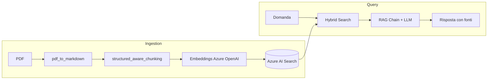

# UAP Project

Sistema **RAG (Retrieval-Augmented Generation)** sul tema UAP (Unidentified Anomalous Phenomena). I documenti PDF vengono convertiti in Markdown, suddivisi in chunk che rispettano la struttura, indicizzati su **Azure AI Search** e interrogati tramite ricerca ibrida e generazione con **Azure OpenAI**.

## Architettura



### Perché: cos'è un RAG e perché lo uso

Un LLM da solo ha due limiti: non conosce i miei documenti e, se non sa una risposta, tende a **inventarla** (allucinazione). Il **RAG (Retrieval-Augmented Generation)** risolve il problema in due fasi:

1. **Retrieval**: dato la domanda, cerco nei miei documenti i passaggi più pertinenti.
2. **Generation**: passo quei passaggi all'LLM come *contesto* e gli chiedo di rispondere **solo** in base a essi, citando le fonti.

Vantaggi: risposte ancorate ai documenti, fonti verificabili, nessun re-training del modello, documenti aggiornabili semplicemente re-indicizzandoli.

Il lavoro si divide in due momenti distinti:
- **Ingestion (offline)**: prepara i documenti una volta sola (PDF -> Markdown -> chunk -> embeddings -> indice).
- **Query (online)**: ad ogni domanda cerca, costruisce il contesto e genera la risposta.

## Struttura del progetto

```
uap-project/
├── pyproject.toml / requirements.txt
├── questions.txt, Q&A.txt          # domande di prova
└── src/uap_project/
    ├── main.py                     # entry point dell'ingestion
    ├── pipeline.py                 # orchestrazione PDF -> chunk -> indice
    ├── docs/
    │   ├── raw_pdf/                # PDF sorgente
    │   └── markdown/               # Markdown generati
    ├── ingestion/                  # conversione e chunking
    ├── vectorstore/                # creazione indice e upload
    ├── retrieval/                  # ricerca keyword / vettoriale / ibrida
    ├── generation/                 # catena RAG
    └── evaluation/                 # valutazione retrieval e generazione
```

## Librerie utilizzate

Scelte principali: **LangChain** come "collante" (standardizza `Document`, prompt e modelli), **Azure OpenAI** per embeddings e LLM, **Azure AI Search** come database sia testuale sia vettoriale (evita di gestire due sistemi), **Ragas** per misurare la qualità invece di giudicarla a occhio.

| Libreria | Utilizzo |
|---|---|
| `pymupdf4llm` | Conversione PDF -> Markdown mantenendo la struttura |
| `langchain-core` | `Document`, prompt, output parser, interfaccia `Embeddings` |
| `langchain-text-splitters` | `MarkdownHeaderTextSplitter`, `RecursiveCharacterTextSplitter` |
| `langchain-openai` | `AzureOpenAIEmbeddings`, `AzureChatOpenAI` |
| `langchain-community`, `langchain-experimental` | Componenti LangChain aggiuntivi |
| `openai` | SDK Azure OpenAI |
| `azure-search-documents`, `azure-core` | Indice, upload e ricerca su Azure AI Search |
| `ragas` (e `litellm`) | Metriche di valutazione della generazione |
| `python-dotenv` | Caricamento delle variabili d'ambiente da `.env` |
| `fastapi`, `uvicorn`, `pydantic`, `jinja2`, `python-multipart` | Stack web/validazione (previsto per esporre il servizio) |
| `sqlalchemy`, `psycopg2-binary` | Accesso a database PostgreSQL (previsto) |

## Moduli

### `main.py`
Entry point dell'ingestion: carica le variabili d'ambiente, crea gli embeddings, crea/aggiorna l'indice su Azure AI Search e lancia la pipeline per ogni PDF in `docs/raw_pdf`.

> **Perché**: le chiavi non stanno nel codice ma in `.env` (buona pratica di sicurezza). L'indice viene creato prima dell'upload perché i campi e la dimensione dei vettori (1536) devono coincidere con il modello di embeddings.

### `pipeline.py`
`run_pipeline(...)` esegue per un PDF i tre passi: conversione in Markdown, chunking, embeddings + indicizzazione. Restituisce i chunk generati.

> **Perché**: separare l'orchestrazione dai singoli passi rende ogni fase testabile e sostituibile (es. cambiare il chunker senza toccare l'indicizzazione).

### `ingestion/`

**Perché.** La qualità di un RAG dipende soprattutto da come sono preparati i dati (*garbage in, garbage out*). Un PDF è un formato di impaginazione, non di struttura: titoli e tabelle non sono esplicitamente marcati. Convertirlo in **Markdown** rende la struttura (`#`, `##`, tabelle) leggibile da una macchina.

Il **chunking** è la divisione del testo in pezzi: serve perché (a) l'embedding di un testo molto lungo "diluisce" il significato, (b) il contesto dell'LLM ha una dimensione limitata e costa a token. Chunk troppo piccoli perdono contesto, troppo grandi diventano rumorosi. L'**overlap** (sovrapposizione tra chunk contigui) evita di spezzare un concetto proprio al confine. Un chunking *structure-aware* segue i titoli del documento invece di tagliare a caso ogni N caratteri.
- **`pdf_to_markdown.py`** – `PDFToMarkDownConverter`: converte uno o tutti i PDF di una cartella in file `.md` con `pymupdf4llm`, così da preservare titoli e tabelle.
- **`structured_aware_chunking.py`** – `chunk_markdown(...)`: divide il Markdown per intestazioni e poi in chunk di dimensione massima configurabile (default 1200 caratteri, overlap 150). Le tabelle non vengono spezzate a metà riga e l'intestazione delle colonne viene ripetuta in ogni chunk; evita chunk composti solo da heading. Ogni chunk riceve metadati (fonte, sezione, indice, tipo di contenuto, categoria tramite `DOCUMENT_CATEGORIES`).

### `vectorstore/`

**Perché.** Un **embedding** è un vettore di numeri (qui 1536) che rappresenta il *significato* di un testo: testi semanticamente simili hanno vettori vicini (similarità coseno). Un **vector store** salva questi vettori e trova rapidamente i più vicini a quello della domanda. Cercare tra milioni di vettori confrontandoli tutti sarebbe lento, quindi si usa un indice approssimato **HNSW** (grafo gerarchico di vicini): molto più veloce, con una piccola perdita di precisione.

Gli ID deterministici (hash SHA-256 di documento + indice del chunk) rendono l'upload **idempotente**: rieseguire l'ingestion aggiorna i chunk esistenti invece di duplicarli. I metadati (`category`, `section`, ...) permettono di filtrare e di citare la fonte.
- **`create_index.py`** – `create_index(...)`: definisce lo schema dell'indice Azure AI Search (campi `id`, `document_id`, `source_file`, `section`, `category`, `content_type`, `chunk_index`, `content`, `content_vector`, `metadata`) con configurazione vettoriale HNSW.
- **`index_documents.py`** – `AzureAISearchVectorStore`: genera gli embeddings dei chunk a batch e li carica nell'indice, con ID deterministici (SHA-256) per evitare duplicati.

### `retrieval/`

**Perché.** Esistono due famiglie di ricerca:
- **Keyword (lessicale, BM25)**: trova le parole esatte; ottima per sigle, nomi e date (es. "AARO", "2004"), ma non capisce i sinonimi.
- **Vettoriale (semantica)**: trova testi dal significato simile anche con parole diverse, ma può mancare termini esatti.

La **hybrid search** combina entrambe e fonde le classifiche (in Azure con *Reciprocal Rank Fusion*), prendendo il meglio dei due approcci: è la scelta predefinita del progetto. Il filtro per `category` permette di restringere la ricerca a un tipo di documento. Il valore `top_k` indica quanti chunk restituire.
- **`azure_retriever.py`** – `AzureAISearchRetriever` con tre modalità: `keyword_search`, `vector_search` e `hybrid_search` (testo + vettore, con filtro opzionale per `category`). I risultati sono convertiti in `Document` LangChain.
- **`test_retriever.py`** – script manuale di prova del retriever.

### `generation/`

**Perché.** La generazione è guidata dal **prompt**: il contesto recuperato viene inserito in un template insieme alla domanda. Le regole del *system prompt* (usa solo il contesto, non inventare, dichiara se le informazioni non bastano, cita le fonti) sono la principale difesa contro le **allucinazioni** e rendono la risposta verificabile. I chunk sono numerati `[1]`, `[2]`... così l'LLM può citarli e l'utente risalire al documento e alla sezione. La catena è costruita con la sintassi LangChain a pipe: `prompt | llm | parser`.
- **`rag_chain.py`** – `UAPRAGChain`: recupera i documenti con la hybrid search, formatta il contesto numerato e interroga l'LLM con un prompt che impone risposte in italiano, basate solo sul contesto e con citazione delle fonti `[1]`, `[2]`, ... Restituisce risposta e fonti.
- **`test_rag.py`** – script di prova della catena RAG.

### `evaluation/`

**Perché.** Senza misure non si sa se una modifica (chunk size, tipo di ricerca, prompt) migliora o peggiora il sistema. Si valutano separatamente le due fasi:
- **Retrieval**: i chunk giusti vengono trovati? Si confrontano le sezioni recuperate con quelle attese nel dataset, con metriche come hit rate e MRR (posizione del primo risultato corretto).
- **Generazione** (Ragas, con un LLM come giudice): *Faithfulness* (la risposta è supportata dal contesto?), *Answer Relevancy* (risponde alla domanda?), *Answer Correctness* (è simile alla risposta di riferimento?).

Separare le due valutazioni aiuta a capire dove sta il problema: se il retrieval è scarso, è inutile modificare il prompt.
- **`dataset.json`** – domande di riferimento con le sezioni attese.
- **`evaluate_retrieval.py`** – confronta keyword, vector e hybrid search con metriche sul dataset.
- **`evaluate_generation.py`** – valuta la generazione con Ragas (`Faithfulness`, `AnswerRelevancy`, `AnswerCorrectness`).
- **`results/`** – output JSON delle valutazioni.

## Configurazione

Python `>= 3.11`, gestione con [uv](https://docs.astral.sh/uv/). Crea un file `.env` nella root:

```env
AZURE_OPENAI_ENDPOINT=
AZURE_OPENAI_API_KEY=
AZURE_OPENAI_API_VERSION=
AZURE_OPENAI_DEPLOYMENT=          # modello di embeddings (1536 dimensioni)
AZURE_SEARCH_ENDPOINT=
AZURE_SEARCH_API_KEY=
AZURE_SEARCH_INDEX_NAME=
```

Per la generazione e la valutazione sono necessarie anche le variabili del deployment chat usate in `generation/test_rag.py` e `evaluation/evaluate_generation.py`.

## Utilizzo

```powershell
uv sync

# 1. Inserisci i PDF in src/uap_project/docs/raw_pdf ed esegui l'ingestion
uv run python -m uap_project.main

# 2. Prova della catena RAG
uv run python -m uap_project.generation.test_rag

# 3. Valutazioni
uv run python -m uap_project.evaluation.evaluate_retrieval --top-k 10
uv run python -m uap_project.evaluation.evaluate_generation --limit 3
```
